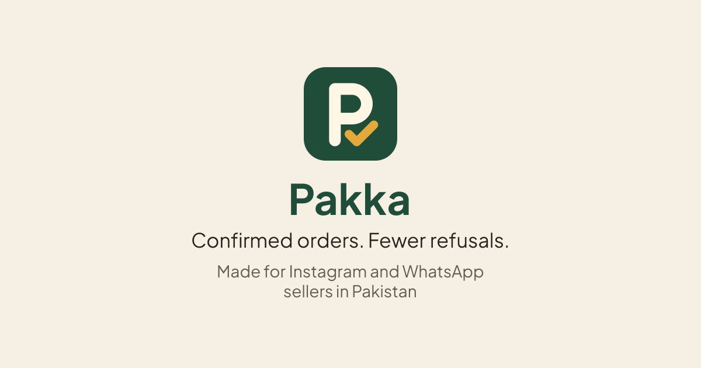
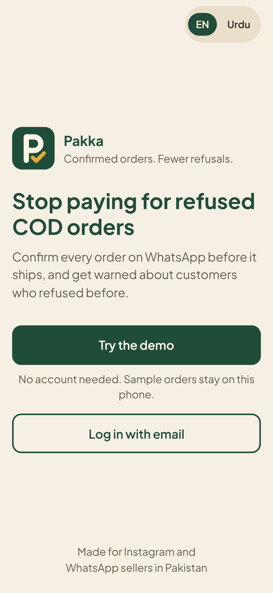
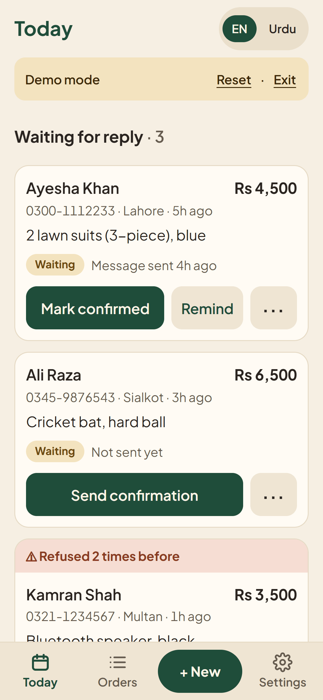
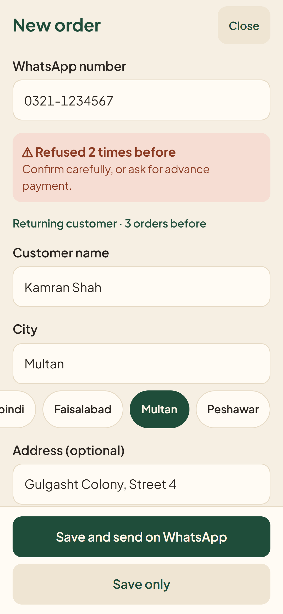
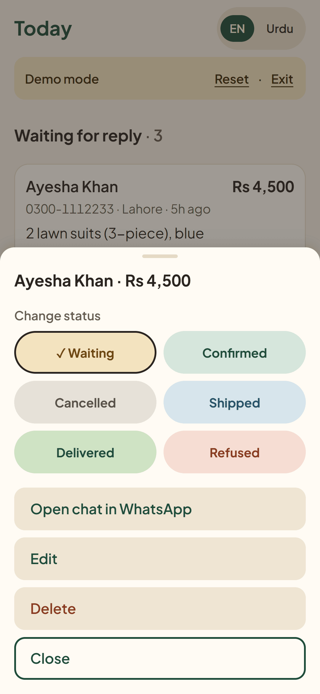

<p align="center">
  
</p>

Pakka is a phone-first web app for small Pakistani sellers who take cash-on-delivery orders on Instagram and WhatsApp.
It helps them confirm each order on WhatsApp before it ships, and warns them about customers who refused before.

**Live: [pakkapk.vercel.app](https://pakkapk.vercel.app).** Try the demo, no account needed.

## Screenshots

<p>
  
  
  
  
</p>

Full length: [Today with all three sections](docs/screenshots/today.png), [Today in Roman Urdu](docs/screenshots/today-roman-urdu.png) and [an order card with the refusal warning](docs/screenshots/order-card-refusal-warning.png).

## Features

- **Confirm on WhatsApp in one tap.** The button opens WhatsApp with the message filled in, and the seller presses send.
- **Refusal warnings with counts.** "Refused 2 times before" shows on the order card, and on the form as soon as the number is typed.
- **Today view.** Orders waiting for a reply, ready to ship, and shipped with a result still to mark.
- **CSV export for couriers.** Exports the orders ready to ship, then offers to mark them as shipped.
- **English and Roman Urdu.** One toggle switches the interface.
- **Demo mode.** Sample orders, saved only in the visitor's browser.

## Key decisions

- **Never messages customers automatically.** The app only builds wa.me links.
- **Refusal history is per seller.** It is enforced with Supabase row-level security, including a database rule that refused orders can't be deleted.
- **Magic link login.** No passwords.
- **Explicit demo mode.** A visible button and seeded data, never a silent fallback.
- **Designed for 360px phones first.** Checked at that width in both languages.
- **CSV cells are protected against formula injection.** Text starting with `=`, `-`, `+` or `@` gets a leading `'`.

## Tech stack

Next.js 16 (App Router, JavaScript), Supabase (Postgres, Auth, RLS), Vercel.

## How it was built

Built in about 2.5 days (25 to 30 hours) by Abdullah Bin Nasir, planned with Claude and implemented with Claude Code.
Two files drove the work: [PROJECT_SPEC.md](PROJECT_SPEC.md) says what it should be, and [CURRENT_STATE.md](CURRENT_STATE.md) says what it does today, with what was and wasn't tested.
Real-phone testing on Android was done by Abdullah.

## Honest limits

- No real sellers yet. This is a portfolio project.
- No live sync between devices.
- Loads the newest 1,000 orders.
- Supabase's built-in email is rate-limited, so only a few login emails go out per hour.
- CSV columns are generic and have not been tested with a courier upload.
- WhatsApp Business API automation is not built.
- A seller can still change a Refused order to another status and then delete it. The database rule only covers orders that are Refused at the time.

## Run it locally

```bash
git clone https://github.com/SheikhAbdullahNasir/pakka.git
cd pakka
npm install
npm run dev
```

Open http://localhost:3000 and tap **Try the demo**. Connecting Supabase and deploying are covered step by step in [docs/SETUP.md](docs/SETUP.md).

## Links

- GitHub: [github.com/SheikhAbdullahNasir](https://github.com/SheikhAbdullahNasir)
- LinkedIn: [linkedin.com/in/abdullahnasir300](https://www.linkedin.com/in/abdullahnasir300)
- Portfolio: [abdullahbinnasir.site](https://abdullahbinnasir.site)
